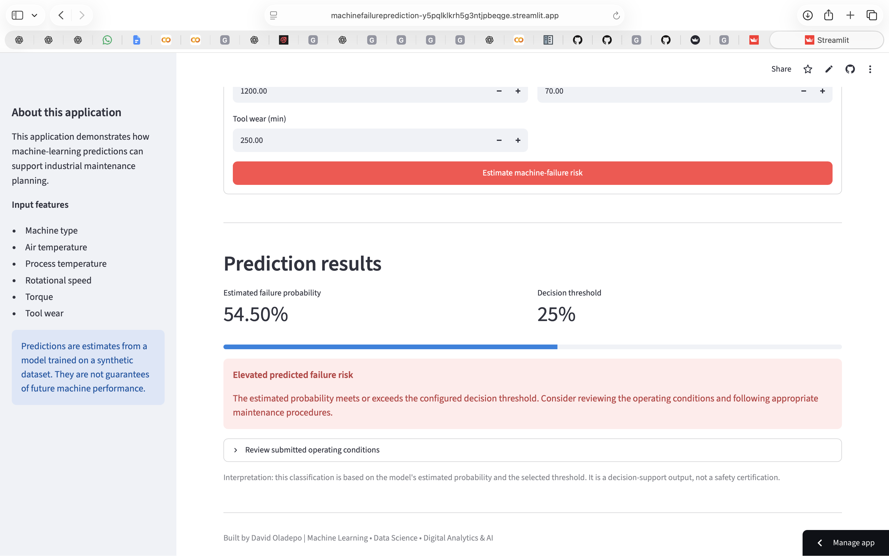
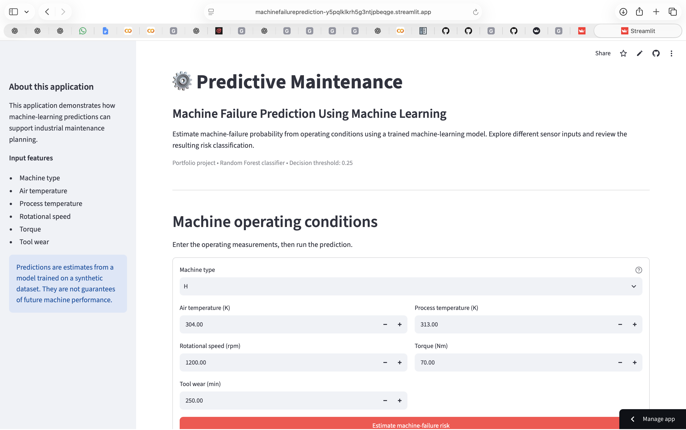

## 🚀 Live Demo

**Try the application:** [Predictive Maintenance — Machine Failure Prediction](https://machinefailureprediction-y5pqlklkrh5g3ntjpbeqge.streamlit.app/)

## 📸 Application Screenshot



*Interactive machine failure prediction application built with Python, Scikit-learn, and Streamlit.*

### Prediction Results



*Example output from the machine-learning model, showing its estimated failure probability against the configured decision threshold.*


[🚀 Launch the Live App](https://machinefailureprediction-y5pqlklkrh5g3ntjpbeqge.streamlit.app/)


Explore how machine operating conditions influence the model's estimated failure probability and risk classification.

**Note:** This is a portfolio demonstration using a model trained on a synthetic dataset. Predictions are estimates and should not be used as the sole basis for real-world maintenance or safety decisions.

---
[](https://machinefailureprediction-y5pqlklkrh5g3ntjpbeqge.streamlit.app/)

# Predictive Maintenance: Machine Failure Prediction Using Machine Learning

An interactive machine-learning application that estimates the probability of machine failure using operational sensor measurements. Built to demonstrate predictive analytics, data preprocessing, model evaluation, and decision-support applications for industrial operations.

## Project Overview

Unexpected equipment failure can lead to costly downtime, production interruptions, and maintenance expenses. Predictive maintenance uses operational data and machine-learning techniques to identify potential failures before they occur.

## ⭐ Key Highlights

* **Machine learning:** Uses a trained Random Forest classifier to estimate machine-failure probability.
* **Interactive application:** Allows users to enter machine operating conditions and receive an immediate prediction.
* **Risk classification:** Applies a configurable 25% decision threshold to classify predicted risk.
* **Model evaluation:** Uses validation metrics to guide threshold selection, balancing precision and recall.
* **Input validation:** Checks operating measurements against the ranges observed during model training.
* **Decision support:** Demonstrates how predictive analytics can support industrial maintenance planning.

**Technologies:** Python · Pandas · Scikit-learn · Joblib · Streamlit


This project develops a binary classification model that estimates machine-failure risk using sensor measurements and machine type. The trained model is integrated into an interactive Streamlit application where users can enter operating conditions and receive a risk prediction.

## Key Features

* **Failure probability estimation:** Estimates the probability of machine failure from operational inputs.
* **Interactive web application:** Enter machine specifications and sensor measurements through a Streamlit interface.
* **Risk classification:** Compares predicted probabilities against a selected decision threshold.
* **Input validation:** Checks numerical inputs against the ranges recorded during model training.
* **Machine-learning pipeline:** Uses preprocessing and classification techniques suitable for mixed numerical and categorical data.
* **Decision-support potential:** Demonstrates how predictive analytics can support maintenance planning and operational risk assessment.

## Technology Stack

* Python
* Pandas and NumPy
* Scikit-learn
* Joblib
* Streamlit
* Machine learning and predictive analytics

## Dataset

The project uses the AI4I 2020 Predictive Maintenance dataset, which contains synthetic industrial operating data and machine-failure labels.

The model uses the following input features:

| Feature                 | Description                   |
| ----------------------- | ----------------------------- |
| Type                    | Machine product-quality type  |
| Air temperature [K]     | Ambient air temperature       |
| Process temperature [K] | Operating process temperature |
| Rotational speed [rpm]  | Machine rotational speed      |
| Torque [Nm]             | Operating torque              |
| Tool wear [min]         | Accumulated tool wear         |

The target variable is `Machine failure`.

Identifiers and failure-specific labels are excluded from the model inputs to reduce target leakage.

## Model Development

The development workflow includes:

1. Data inspection and exploratory data analysis.
2. Feature selection and target definition.
3. Stratified training, validation, and test splitting.
4. Numerical scaling and categorical encoding.
5. Model development using Logistic Regression and Random Forest classifiers.
6. Model comparison using classification and ranking metrics.
7. Decision-threshold selection using validation data.
8. Model export and integration into the Streamlit application.

The selected Random Forest model uses a decision threshold of **0.25**, chosen through validation-based F1-score evaluation. The threshold is configurable through the project's saved configuration file.

## Validation Results

At the selected threshold of 0.25, the model achieved the following validation results:

| Metric    | Validation result |
| --------- | ----------------: |
| Accuracy  |            97.80% |
| Precision |            66.07% |

## 🛠️ Installation and Getting Started

### Prerequisites

* Python 3.10 or a compatible version supported by the listed dependencies
* Git

### 1. Clone the repository

```bash
git clone https://github.com/David-Oladepo/Machine_failure_prediction.git
cd Machine_failure_prediction
```

### 2. Install dependencies

```bash
python -m pip install -r requirements.txt
```

### 3. Run the application

```bash
python -m streamlit run app.py
```

Streamlit will display a local URL in your terminal. Open that URL in your browser to interact with the application.

### Required project files

Make sure these files remain in the project directory:

* `app.py` — interactive Streamlit application
* `machine_failure_model.pkl` — trained machine-learning model
* `final_threshold.json` — configured classification threshold
* `training_ranges.json` — input ranges used by the application
* `requirements.txt` — Python dependencies
* `README.md` — project documentation

### Live demo

You can also use the deployed application without installing anything:

[Launch Predictive Maintenance](https://machinefailureprediction-y5pqlklkrh5g3ntjpbeqge.streamlit.app/)
